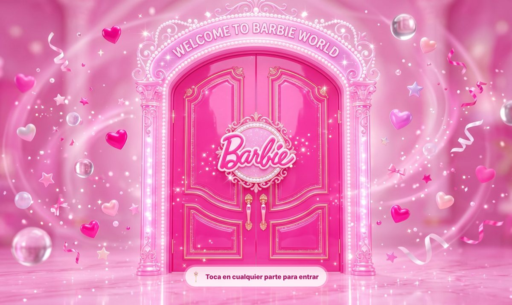
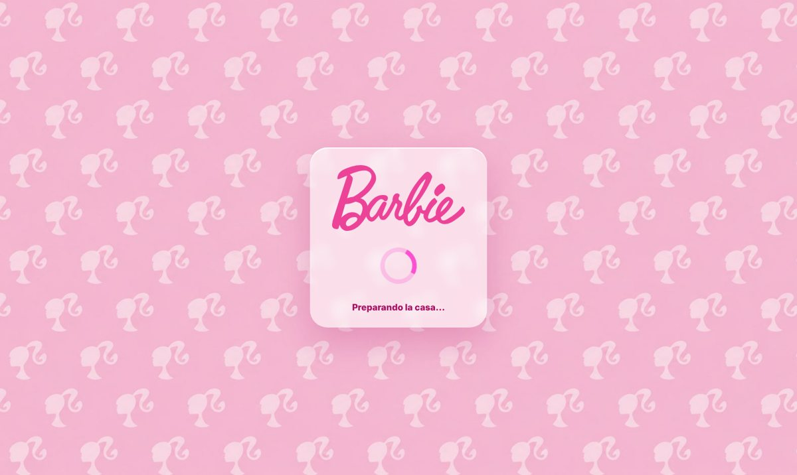
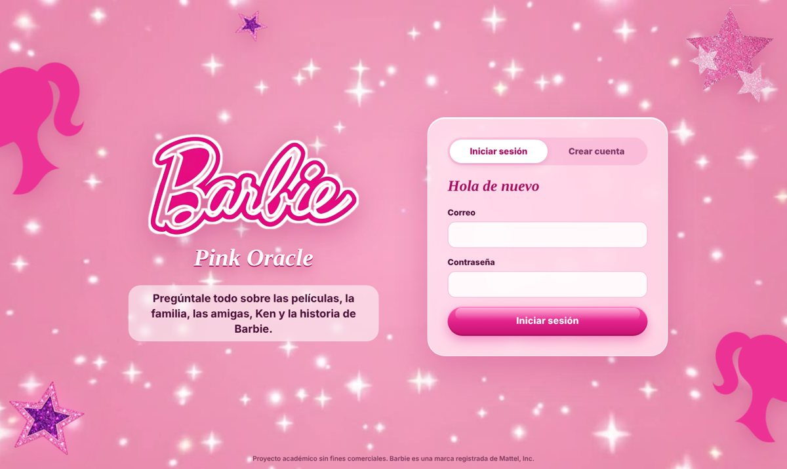
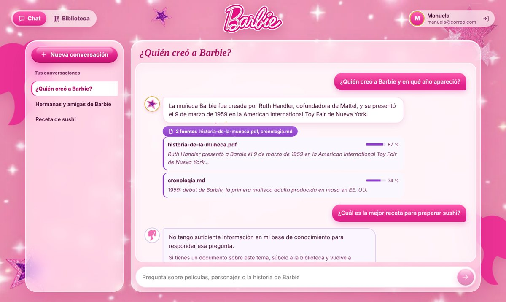
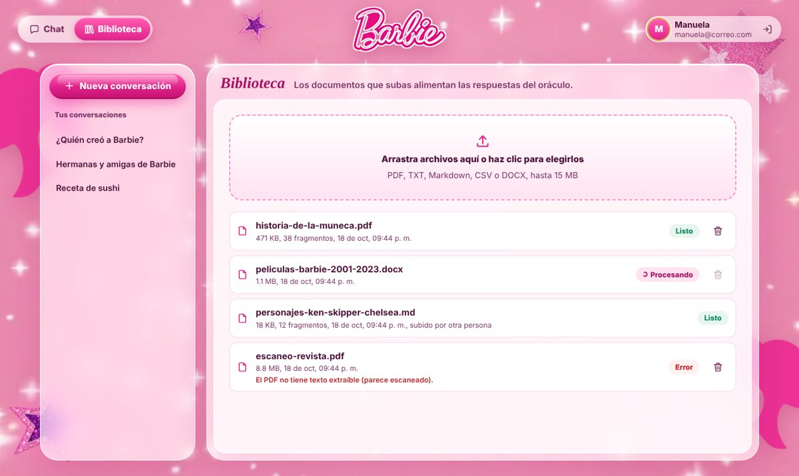
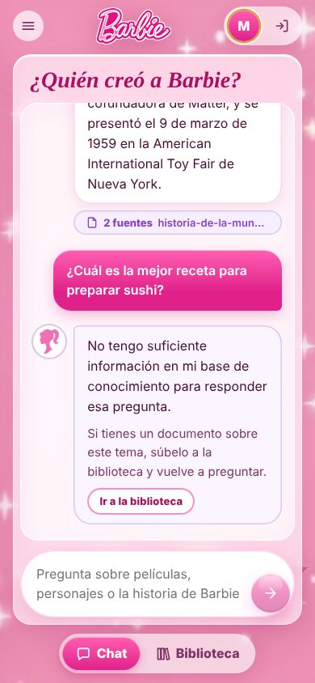

# Pink Oracle

Agente inteligente que responde preguntas sobre el universo Barbie: las películas, su familia y amigas, Ken y la historia de la muñeca. Funciona con **LangChain + LangGraph** y una arquitectura **RAG**: cada respuesta sale de documentos guardados en una base vectorial y, si no hay información suficiente, el agente lo dice en vez de inventar.


| | |
|---|---|
| **Frontend** | React 18 + Vite, desplegado en Vercel; animación de carga con lottie-web |
| **Backend** | FastAPI (Python 3.11), desplegado en Render |
| **Autenticación** | Supabase Auth (JWT), con todos los endpoints de `/api` protegidos |
| **Historial y documentos** | Supabase Postgres con Row Level Security |
| **Agente** | LangChain + LangGraph |
| **Modelo local** | Ollama con `qwen2.5:3b` (LLM) y `bge-m3` (embeddings), expuesto con ngrok |
| **Base vectorial** | pgvector en Supabase |

> Pon aquí la URL del frontend y la del backend cuando estén desplegados.

## Experiencia

1. **Carga:** patrón de siluetas con la animación rosa (Lottie) mientras se descarga la puerta.
2. **Puerta:** imagen de bienvenida a pantalla completa; un clic en cualquier parte, o Enter, la abre.
3. **Video de entrada:** las puertas se abren en una explosión de brillos, con botón "Saltar". Se sirve en WebM y en MP4.
4. **App:** el video termina en el mismo fondo de destellos que usa la app, así que la transición no tiene corte.
5. **Varita mágica:** el puntero es una varita que deja una estela de destellos.

| Puerta | Carga |
|---|---|
|  |  |

| Acceso | Chat con fuentes y rechazo |
|---|---|
|  |  |

| Biblioteca de documentos | Móvil |
|---|---|
|  |  |

## Estructura

```
.
├── backend/
│   ├── app/                 # main.py, configuración, seguridad (JWT) y esquemas
│   ├── controllers/         # rutas HTTP: chat, conversaciones, documentos, usuario
│   ├── services/            # lógica de negocio (chat y carga de documentos)
│   ├── repositories/        # acceso a datos (Supabase o memoria)
│   ├── agents/              # agente LangGraph: grafo, prompts, LLM (Persona 1)
│   ├── vectorstore/         # pgvector: carga, fragmentación, búsqueda (Persona 1)
│   ├── scripts/             # cargar corpus, probar agente, sincronizar biblioteca
│   ├── supabase/schema.sql  # tablas y políticas RLS
│   ├── tests/               # pruebas automáticas de la API
│   ├── requirements.txt
│   └── Dockerfile
├── frontend/
│   ├── src/
│   │   ├── pages/           # AuthPage, ChatPage, LibraryPage
│   │   ├── components/      # Intro (puerta + video), LoadingScreen, SparkleTrail (varita),
│   │   │                    # Decorations, Sidebar, Message, Icons
│   │   ├── context/         # sesión (AuthContext) y avisos (ToastContext)
│   │   └── lib/             # cliente de Supabase, cliente de la API, rutas
│   ├── public/              # intro/ (puerta y video), deco/ (logo, estrellas), cursor/ (varita), fondos/
│   ├── package.json
│   └── Dockerfile
├── data/                    # corpus de fichas de Barbie y documento para la demo
├── docs/                    # diagrama, capturas, documento técnico y diapositivas
├── docker-compose.yml
├── render.yaml              # despliegue del backend en Render
└── .env.example
```

## API

Todos los endpoints de `/api` exigen el header `Authorization: Bearer <token de Supabase>`. Sin token responden `401`. La documentación interactiva queda en `/docs`.

| Método | Ruta | Descripción |
|---|---|---|
| `GET` | `/health` | Estado del servicio (público, lo usa Render) |
| `GET` | `/api/me` | Usuario autenticado |
| `POST` | `/api/chat` | Envía `{question, conversation_id?}` y devuelve la respuesta con `sources` y `rejected` |
| `GET` | `/api/conversations` | Historial de conversaciones del usuario |
| `GET` | `/api/conversations/{id}/messages` | Mensajes de una conversación |
| `DELETE` | `/api/conversations/{id}` | Elimina una conversación |
| `POST` | `/api/documents` | Sube un archivo (`multipart/form-data`, campo `file`); se procesa en segundo plano |
| `GET` | `/api/documents` | Lista los documentos y su estado (`processing`, `ready`, `error`) |
| `DELETE` | `/api/documents/{id}` | Elimina el documento y sus fragmentos (solo quien lo subió) |

### Contrato entre la API y el agente

La API habla con el agente solo a través de [`backend/services/agent_gateway.py`](backend/services/agent_gateway.py):

```python
from agents import ask                                   # Persona 1
from vectorstore import ingest, delete_document, listar_documentos

ask(question, user_id, history) -> {"answer", "rejected", "sources": [{"doc", "fragment", "score"}], "error"}
ingest(file_path, doc_id, filename) -> int    # lanza ValueError con un mensaje para el usuario
delete_document(doc_id) -> int
```

- `history` son los últimos 6 mensajes `[{role, content}]`. La API guarda el historial en Supabase.
- `error: true` (Ollama o la base vectorial caídos) se responde como **503**: el chat muestra el error con "Reintentar" y no se guarda nada.
- `ingest` corre en segundo plano. Si lanza `ValueError` (formato inválido, PDF escaneado…), la biblioteca muestra ese mensaje en el documento.
- Con `AGENT_MODE=mock` se usa un agente simulado para probar la interfaz sin Ollama.

### Traer las actualizaciones del agente

La Persona 1 trabaja en la rama `agente`. Para traer sus cambios a `main`:

```powershell
git checkout main
git pull origin agente
git push origin main
```

## Ejecutar en local (Windows)

Requisitos: Python 3.10+, Node.js 20+ y Ollama con los modelos del agente:

```powershell
ollama pull qwen2.5:3b
ollama pull bge-m3
```

### 1. Supabase (una sola vez)

1. En Supabase abre **SQL Editor**, pega el contenido de `backend/supabase/schema.sql` y presiona **Run**.
2. Ve a **Project Settings > API** y copia la URL del proyecto, la llave `anon` (o *publishable*) y la llave `service_role` (o *secret*).
3. Para las pruebas, en **Authentication > Sign In / Providers > Email** puedes desactivar *Confirm email* y así no tener que confirmar cada cuenta nueva.

### 2. Backend

```powershell
cd backend
python -m venv .venv
.venv\Scripts\activate
pip install -r requirements.txt
copy .env.example .env      # y llena los valores
uvicorn app.main:app --reload --port 8000
```

Abre http://localhost:8000/docs para ver la API.

Si el corpus ya está cargado en la base vectorial, regístralo en la biblioteca de la app (una sola vez):

```powershell
python scripts/sincronizar_biblioteca.py
```

Para cargar el corpus desde cero: `python scripts/cargar_documentos.py ../data/corpus`.

Para correr las pruebas: `python -m pytest -q`

### 3. Frontend

```powershell
cd frontend
npm install
copy .env.example .env      # y llena los valores
npm run dev
```

Abre http://localhost:5173.

### Con Docker

```powershell
copy .env.example .env      # y llena los valores
docker compose up --build
```

## Despliegue

### Ollama con ngrok (modelo local)

El modelo corre en el PC con más RAM y se expone con un dominio fijo gratis de ngrok, protegido con usuario y contraseña:

```powershell
ollama serve
ngrok http 11434 --url=TU-DOMINIO.ngrok-free.app --basic-auth="usuario:contraseña" --host-header="localhost:11434"
```

Ese PC tiene que estar encendido durante la demostración. Plan B: correr todo en local (`OLLAMA_URL=http://localhost:11434`).

### Backend en Render

1. En Render ve a **New > Blueprint**, elige este repositorio y Render leerá `render.yaml`.
2. Llena las variables marcadas: `SUPABASE_URL`, `SUPABASE_SERVICE_ROLE_KEY`, `FRONTEND_URL` (la URL de Vercel), `OLLAMA_URL`, `OLLAMA_USER`, `OLLAMA_PASS` y `DATABASE_URL`.
   - `DATABASE_URL`: en Supabase ve a **Connect** y copia la cadena del **Session pooler**, porque la conexión directa usa IPv6 y Render no lo soporta. Cambia el prefijo `postgresql://` por **`postgresql+psycopg://`**.
3. Comprueba que `https://<tu-backend>.onrender.com/health` responde `{"status": "ok"}`.

### Frontend en Vercel

1. En Vercel ve a **Add New > Project**, elige este repositorio y en **Root Directory** pon `frontend`.
2. En Environment Variables agrega `VITE_SUPABASE_URL`, `VITE_SUPABASE_ANON_KEY` y `VITE_API_URL` (la URL de Render).
3. Presiona **Deploy**. Después copia la URL de Vercel en `FRONTEND_URL` de Render y en Supabase, en **Authentication > URL Configuration > Site URL**.

## Variables de entorno

| Variable | Dónde | Descripción |
|---|---|---|
| `SUPABASE_URL` | backend | URL del proyecto de Supabase |
| `SUPABASE_SERVICE_ROLE_KEY` | backend | Llave secreta; nunca va en el frontend ni en GitHub |
| `SUPABASE_JWT_SECRET` | backend | Solo si el proyecto usa la llave JWT legacy (HS256) |
| `FRONTEND_URL` | backend | Orígenes permitidos por CORS |
| `DATA_BACKEND` | backend | `supabase` o `memory` |
| `AGENT_MODE` | backend | `real` (agente de LangGraph) o `mock` (simulado) |
| `OLLAMA_URL` / `OLLAMA_USER` / `OLLAMA_PASS` | backend | URL de ngrok hacia Ollama y sus credenciales |
| `LLM_MODEL` / `EMBED_MODEL` | backend | `qwen2.5:3b` y `bge-m3` |
| `SIMILARITY_THRESHOLD` | backend | Similitud mínima para aceptar un fragmento (0.5) |
| `DATABASE_URL` | backend | Postgres de Supabase para pgvector (`postgresql+psycopg://`, Session pooler) |
| `MAX_UPLOAD_MB` / `ALLOWED_EXTENSIONS` | backend | Límites de carga de archivos |
| `VITE_SUPABASE_URL` / `VITE_SUPABASE_ANON_KEY` | frontend | Cliente público de Supabase |
| `VITE_API_URL` | frontend | URL del backend |

## Seguridad

- El frontend solo muestra la aplicación cuando hay una sesión activa de Supabase.
- El backend valida la firma, la audiencia y la expiración del JWT en **cada** request a `/api`, con las llaves públicas (JWKS) del proyecto o con el secreto legacy.
- Cada consulta filtra por `user_id`, así que nadie ve conversaciones ajenas. Además, RLS en Postgres bloquea el acceso directo con la llave pública.
- La carga de archivos valida la extensión, el tamaño máximo y que el archivo no esté vacío, y solo quien subió un documento puede eliminarlo.

## Equipo

| Persona | Responsabilidad |
|---|---|
| Persona 1 | Agente e inteligencia artificial: LangGraph, RAG, Ollama, pgvector |
| Persona 2 | Aplicación web e infraestructura: React, FastAPI, Supabase Auth, despliegue |

---

Proyecto académico sin fines comerciales. Barbie y su logo son marcas registradas de Mattel, Inc.; este proyecto no está afiliado a Mattel.
